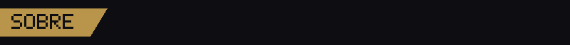
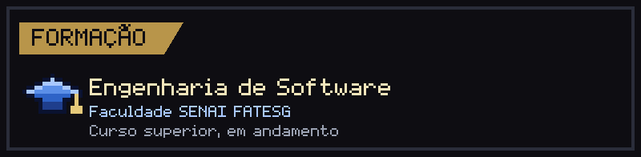
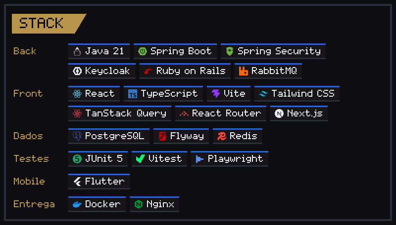
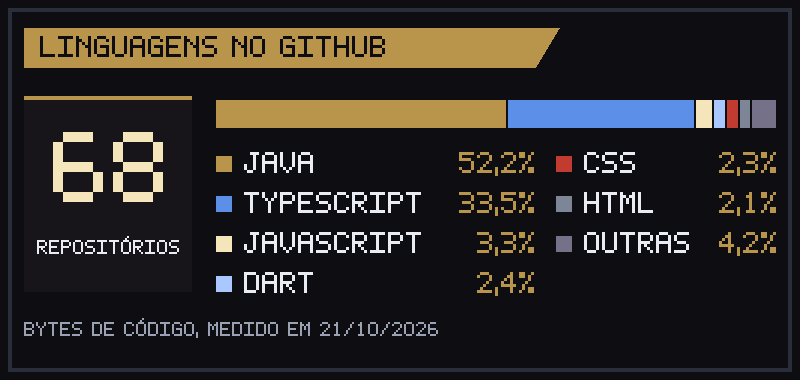
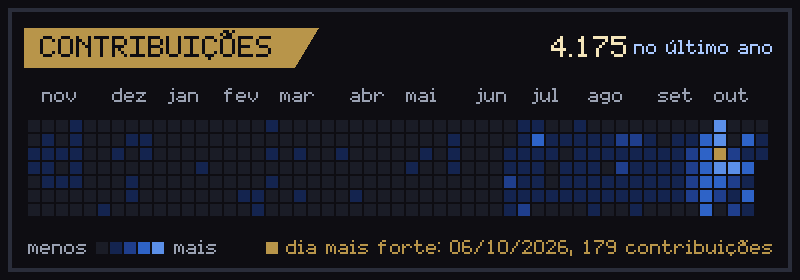
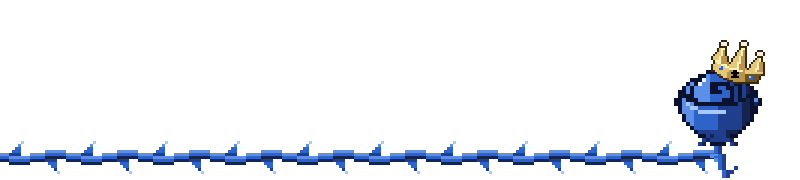

<h3></h3>

Dev full stack. Construo sistemas web inteiros, da API à tela: Java e Spring Boot no back, React e TypeScript no front, PostgreSQL e Keycloak no meio. Estudo Engenharia de Software na Faculdade SENAI FATESG.

Hoje sou gerente de tecnologia da EMATER Goiás e da ASBRAER. Na ASBRAER, desenvolvi o portal do Censo, usado pelos usuários da associação. Na EMATER, desenvolvo a intranet e os sistemas internos que deixam o fluxo de trabalho das equipes mais ágil. O código desses sistemas é privado, por isso não aparece aqui.

