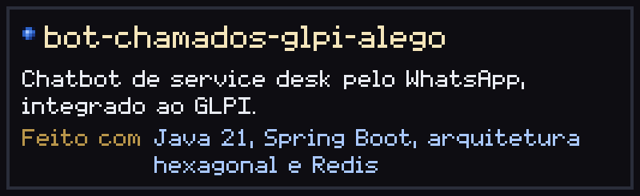
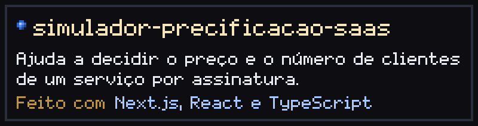
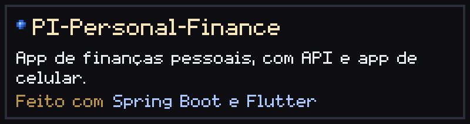
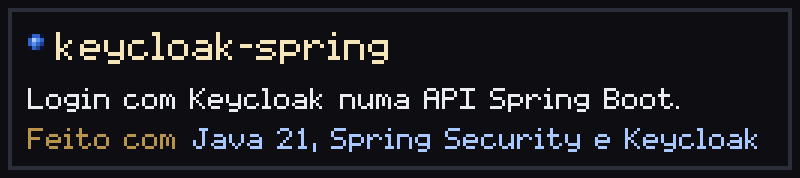

<h3></h3>

Dev full stack. Construo sistemas web inteiros, da API à tela: Java e Spring Boot no back, React e TypeScript no front, PostgreSQL e Keycloak no meio. Estudo Engenharia de Software na Faculdade SENAI FATESG.

No trabalho, desenvolvo sistemas de gestão com essa mesma stack. O código é privado, por isso não aparece aqui.

<h3></h3>

